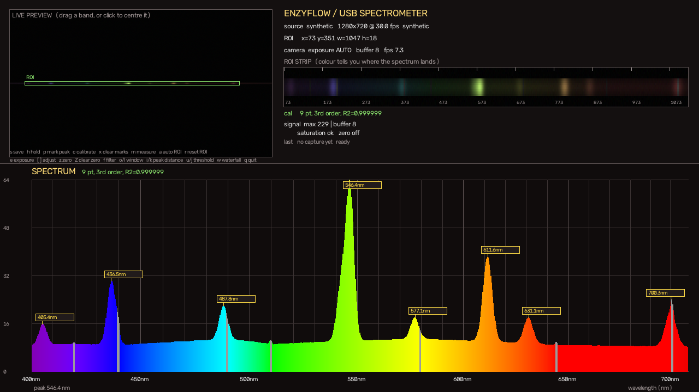

# Enzyflow 电脑端 USB 光谱仪（Linux / 二次开发）

这是一个面向当前这台 Linux 电脑的 USB 摄像头式光谱仪采集程序。它不是把
Raspberry Pi 版本原样搬过来，而是按下面三份代码的原理重新组织的：

1. 你已有的 VB.NET 软件（Theremino / 小圃类 Windows 软件的功能模型）；
2. [PySpectrometer2](https://github.com/leswright1977/PySpectrometer2) 的 USB 摄像头版本；
3. [spectro-cam-rs](https://github.com/DerFetzer/spectro-cam-rs) 的 Linux/跨平台采集和参考校正思路。

代码只依赖 **NumPy + OpenCV**，可以在没有桌面环境的服务器上用 CSI/SSH
采集，也可以在 Omarchy/Hyprland 下直接开窗口。

> 重要说明：本次在 `enzyflow/` 中没有找到 `.vb`、`.vbproj` 或 `.sln`
> 文件。因此这里的实现是“按 VB.NET 软件的功能和光谱仪原理重写”的独立
> Python 版本，没有逐行复制 VB.NET 代码。若你把 VB.NET 工程放进
> `vbnet_source/`，可以继续做逐函数对照移植；相关映射见
> [`docs/VBNET_TO_PYTHON.md`](docs/VBNET_TO_PYTHON.md)。



> 上图是 `--synthetic` 合成光源的界面演示；真实设备需要打开光路并做
> 波长标定，界面布局相同。

---

## 1. 本机适配结果

当前电脑上已经识别到两台 UVC 摄像头：

| 设备 | VID:PID | 节点 | 用途 |
|---|---|---|---|
| Integrated Camera: Integrated C | `5986:114e` | `/dev/video0`（采集）、`/dev/video1`（metadata） | 笔记本内置摄像头，程序会自动排除 |
| **USB 2.0 Camera: USB-ZH** | **`0c68:6464`** | **`/dev/video2`（采集）、`/dev/video3`（metadata）** | **当前唯一外接 UVC；按名称先按光谱仪处理，需用画面确认** |

程序默认按以下顺序找设备：

1. `--device` 指定的设备；
2. 配置里保存的 `/dev/videoN`；
3. 配置里保存的 USB `VID:PID`（换 USB 口后仍然有效）；
4. 名称里包含 `sonix` / `usb-zh` / `spectro` 的采集节点；
5. 排除 `integrated` / `bison` / `facetime` 后的唯一外接采集节点。

实测结果：`/dev/video2` 可以打开，格式为 **MJPG 1280×720 @ 31 fps**，
支持 `brightness`、`contrast`、`saturation`、`gamma`、`sharpness`、
`auto_exposure`、`exposure_time_absolute` 等 V4L2 控制。

目前摄像头在自动曝光下画面接近全黑（最大值只有 4–16/255）。把曝光手动
加到 5000、亮度 0、gamma 100 后能看到**室内场景/灯管**，而不是一条狭缝
光谱。这说明当前 `0c68:6464` 要么是普通 USB 摄像头，要么是光谱仪的
摄像头没有对准狭缝/光栅；程序本身能正常打开和采集，但**不能把室内灯管
当成光谱**。请先确认设备的物理光路：光谱仪摄像头的画面应该是暗背景上的
一条横向彩色带（或狭缝像），而不是房间。

自动 ROI 只是找“最亮的水平带”，如果预览里是房间，它会框到灯管；这不是
波长数据。请以预览画面为准。打开狭缝并对准灯后，再用 `a` 自动框选或
鼠标拖框。程序会在画面上显示 `LOW LIGHT`，提示你打开光路或增加曝光。

---

## 2. 快速开始

所有命令都在这个目录执行：

```bash
cd ~/Work/enzyflow/spectrometer

# 第一次运行会自动创建 .venv 并安装 numpy + opencv-python
./run.sh doctor          # 检查环境、设备、配置
./run.sh devices --controls
./run.sh run             # 打开实时窗口
```

没有接光谱仪时，可以先用确定性的合成光谱熟悉界面：

```bash
./run.sh run --synthetic
```

常用命令：

```bash
# 无界面采集 30 帧并求平均，输出 CSV/JSON/PNG
./run.sh capture --frames 30 --out runtime/captures/lab.csv

# 连续采集 60 秒，每秒一行 JSONL（便于后期和 AS7341 数据对齐）
./run.sh capture --duration 60 --interval 1 --jsonl runtime/captures/run.jsonl

# 从已知谱线做标定（像素:波长，像素是整幅画面的绝对 x）
./run.sh calibrate --points "90:405.4, 580:546.5, 800:611.6"

# 导入 PySpectrometer2 的 caldata.txt
./run.sh calibrate --from-caldata /path/to/caldata.txt

# 导出 PySpectrometer2 兼容的 caldata.txt
./run.sh calibrate --points "90:405.4, 580:546.5, 800:611.6" \
    --caldata-out runtime/caldata.txt

# 生成钨丝灯参考光谱（用于相对响应校正）
./run.sh reference-tungsten --temperature 2800 --out runtime/tungsten.csv
```

如果你使用桌面启动器，可以把它指向：

```
/home/orange/Work/enzyflow/spectrometer/run.sh
```

---

## 3. 窗口布局和按键

窗口上半部分是：

- 左侧：实时预览，绿色框是当前 ROI（光谱带）；
- 右上：设备、分辨率、帧率、曝光、标定状态；
- 右中：ROI 条带放大图，用来确认光谱是否落在框内；
- 右下：`LOW LIGHT` / 饱和提示、保存状态和按键提示；
- 下半部分：按波长着色的光谱曲线，竖线是 10 nm / 50 nm 网格，
  黄色标签是自动检测到的峰。

### 键盘

| 键 | 功能 |
|---|---|
| `s` | 保存 CSV + JSON + 光谱 PNG + 原始帧 PNG |
| `h` | 峰值保持（hold peaks）开关 |
| `m` | 测量光标：显示鼠标位置的波长/像素 |
| `p` | 进入/退出“标定点”模式，然后在光谱图上点击峰 |
| `c` | 用刚才点击的峰做标定（会在终端里询问已知波长） |
| `x` | 清除标定点 |
| `a` | 自动检测光谱带（ROI） |
| `r` | 恢复居中窄带 ROI |
| `e` | 自动曝光 / 手动曝光切换 |
| `[` `]` | 手动曝光减/加（约 ×0.8 / ×1.25，V4L2 的 100 µs 单位） |
| `b` | 清空多帧平均缓存 |
| `z` | 把当前光谱设为“零参考”（吸收/暗背景） |
| `Z` | 清除零参考 |
| `f` | Savitzky-Golay 平滑开关 |
| `o` / `l` | 平滑窗口加大/减小 |
| `i` / `k` | 峰最小间距加大/减小 |
| `u` / `j` | 峰检测阈值提高/降低 |
| `w` | 打开/关闭瀑布图窗口 |
| `q` / `Esc` | 退出 |

### 鼠标

- 在预览区**拖一个框**：设置 ROI 的 x/y/w/h；
- 在预览区**单击**：以点击高度为中心，设置整幅宽度的窄带；
- 在光谱图里点击：只有打开 `p`（CLICK PEAKS）时才添加标定点。

> 标定点保存的是**整幅画面的绝对像素 x**，不是 ROI 内的相对坐标。
> 因此你左右移动 ROI 不会破坏已有标定；这是和 PySpectrometer2 的
> `caldata.txt`（相对 ROI 宽度）不同的地方，导入/导出时会自动换算。

---

## 4. 波长标定（最重要的一步）

光谱仪出厂/DIY 装配后，像素位置和波长的关系不是线性的。程序采用和
PySpectrometer2 相同的做法：

- 3 个标定点 → 2 阶多项式；
- 4 个及以上 → 3 阶多项式；
- 输出 R²，越接近 1 越好；
- 标定保存为 `runtime/calibration.json`，下次自动加载。

### 4.1 用荧光灯标定（推荐）

准备一盏**荧光灯**（节能灯/日光灯管），它有几条很明显的发射线：

| 波长 (nm) | 来源 | 附近颜色 |
|---:|---|---|
| 405.4 | 汞 | 紫 |
| 436.6 | 汞 | 蓝紫 |
| 487.7 | 铽 | 蓝绿 |
| 542.4 | 铽 | 绿 |
| 546.5 | 汞 | 绿（通常最强） |
| 577.0 | 汞 | 黄 |
| 611.6 | 铕 | 橙红 |
| 631.1 | 铕 | 红 |
| 700.0 | 铕/其他 | 深红 |

操作：

1. 打开光谱仪狭缝，对准荧光灯，让彩色光谱带落在预览中间；
2. 用 `e` 关掉自动曝光（或按 `[` / `]` 调到峰值约 200，但不要饱和）；
3. 按 `a` 自动框 ROI，或鼠标拖框；
4. 按 `h` 打开峰值保持（灯可以暂时移开，峰不会马上消失）；
5. 按 `p`，在光谱图上依次点击 4–6 个明显的峰；
6. 按 `c`，终端会问每个像素对应的波长，输入上表中的数值；
7. 看终端输出的 R²；如果低于 0.999，检查是不是点错了峰；
8. 按 `s` 保存一张带标定的光谱图，核对其他未参与标定的峰。

也可以完全用命令行：

```bash
./run.sh calibrate --points "90:405.4, 580:546.5, 800:611.6"
```

`--points` 里的像素是整幅画面的 x，不是显示窗口缩放后的 x。使用
`./run.sh capture --out ...` 保存的 CSV 里，`pixel` 列就是绝对 x，
可以直接对照。

### 4.2 检查标定

重新采集一条荧光灯或钠灯谱，查看峰标签：

- 荧光灯：546.5 nm 附近应该是最强绿峰；
- 钠灯：589.0 / 589.6 nm 双线（实际会合成一个峰）；
- 日光：Fraunhofer 线不容易辨认，不建议第一次标定用。

如果峰位置整体偏移，通常是 ROI 的 x 变了但标定点没重做。本程序按绝对
像素计算，理论上移动 ROI 不会偏移；如果换了摄像头分辨率或镜头，需要
重新标定。

### 4.3 标定文件格式

`runtime/calibration.json` 是普通 JSON：

```json
{
  "schema": 1,
  "type": "wavelength_calibration",
  "points": [[90, 405.4], [580, 546.5], [800, 611.6]],
  "degree": 2,
  "coefficients": [ ... ],
  "r_squared": 0.9999,
  "calibration_id": "…"
}
```

`Calibration.load()` 也接受 PySpectrometer2 的两行 `caldata.txt`：

```
90,580,800
405.4,546.5,611.6
```

---

## 5. 数据与保存

### 5.1 CSV

每次保存会生成 `spectrum-YYYYmmdd-HHMMSS.csv`：

| 列 | 含义 |
|---|---|
| `pixel` | 整幅画面绝对 x |
| `wavelength_nm` | 标定后的波长；未标定时为空 |
| `r` / `g` / `b` | ROI 行平均后的相机通道值（0–255） |
| `intensity` | `(r+g+b)/3`，已乘通道增益，未做辐射标定 |
| `display` | 经平滑/峰值保持后的显示值 |
| `luminance` | OpenCV 灰度亮度 |

强度单位必须理解为**相机计数**，不是 W/m²、lux 或绝对光谱辐照度。

### 5.2 JSON sidecar

同名 `.json` 记录设备、ROI、曝光、标定、饱和状态、峰值位置和文件列表。
适合和实验记录、样品编号一起归档。

### 5.3 JSONL（和 ESP32 数据对齐）

`--jsonl` 或 `--duration` 会输出一行一个 JSON 对象，字段包括：

```json
{
  "schema": 1,
  "source": "pc.usb_spectrometer",
  "device_id": "/dev/video2",
  "seq": 12,
  "t_monotonic_ms": 1234567,
  "t_wall": "2026-11-03T14:00:00.123+08:00",
  "event": "measurement",
  "camera": {...},
  "roi": {"x": 0, "y": 356, "w": 1280, "h": 8},
  "exposure": {"auto": false, "value": 300, "units": "V4L2 exposure_time_absolute (100 us units on this camera)"},
  "calibration": {...},
  "units": {"wavelength": "nm", "intensity": "camera counts 0..255 ..."},
  "wavelength_nm": [...],
  "intensity": [...],
  "r": [...], "g": [...], "b": [...],
  "stats": {...}
}
```

ESP32/AS7341 的数据继续使用它原来的 `schema=1, source=esp32.as7341`，
两边通过 `source` / `device_id` 区分，通过**电脑接收时间**做近似对齐。
不要把 ESP32 的 `t_ms`（会回绕的板载计时）当成 UTC 时间。

### 5.4 吸收/透射测量（零参考）

1. 先放空白/参比，按 `z` 记录零参考；
2. 换样品，光谱会减去零参考；
3. 按 `Z` 清除零参考。

这只做相对吸收；要做真正的吸光度，需要另外计算
`A = -log10(I_sample / I_reference)`，并且保证两次测量的曝光、ROI、
光源稳定。当前 `z` 是逐像素减法，适合观察峰的变化，不替代严格分光光度
计算。

### 5.5 参考响应校正

`--reference-csv runtime/tungsten.csv` 会把测量曲线按
`reference / measured` 做逐波长缩放。它校正的是相机+光栅的相对响应形状，
不是绝对定标。参考 CSV 至少要有两列：`wavelength_nm,intensity`。

### 5.6 通道增益和相机响应线性化

`runtime/config.json` 的 `processing` 段支持：

```json
{
  "linearize": "off",     // off | rec601 | rec709 | srgb
  "gain_r": 1.0,
  "gain_g": 1.0,
  "gain_b": 1.0,
  "buffer_size": 8,
  "savgol_enabled": true,
  "savgol_window": 9,
  "savgol_order": 3
}
```

- `linearize` 用于把相机 sRGB/Rec.601/Rec.709 编码近似还原成线性响应；
  默认 `off`，因为很多 UVC 相机的“亮度/gamma”控制已经改过曲线；
- `gain_*` 是软件增益，乘在平均后的 RGB 上，再合成 `intensity`；
- 这些值也可以在 Python 二次开发里直接改 `ProcessingConfig`。

相机硬件的曝光/亮度/gamma 建议用 `v4l2-ctl` 或 `guvcview` 调，软件只做
光谱处理。程序每次保存都会把曝光和 ROI 写进 JSON，方便复现实验条件。

---

## 6. 和 ESP32 / AS7341 一起用

现有 enzyflow 的 ESP32 程序通过 USB 串口输出 JSONL（`esp32.as7341`）。
本程序完全不碰 ESP32，也不需要 ESP32 做 USB Host：

```text
AS7341 -> ESP32-S3 -> /dev/ttyACM0 -> 电脑采集程序
USB 光谱仪 -> /dev/video2 -> 电脑上的本程序
```

建议同时开两个进程：

```bash
# 终端 1：ESP32（沿用你现有的 Thonny/串口采集方式）
# 终端 2：USB 光谱仪，每秒采一条
./run.sh capture --duration 600 --interval 1 \
    --jsonl runtime/captures/spectrometer.jsonl
```

注意事项：

- 不要让 Thonny 和采集程序同时占用 `/dev/ttyACM0`；
- 光谱仪是 UVC 摄像头，和 ESP32 的串口互不影响；
- 只有电脑端光谱仪记录自带 `t_wall`；ESP32 记录只有会回绕的板载 `t_ms`，
  需在电脑接收时另行记录接收时间，才能做秒级近似对齐；
- 真正同步触发需要额外的硬件触发/时钟设计，当前只是软件时间戳；
- 不要把 AS7341 的 8 个离散波段当成连续光谱，也不要把相机 RGB
  当成 CIE 颜色。

---

## 7. 二次开发指南

### 7.1 文件结构

```
spectrometer/
├── run.sh                     # 首次自动建 venv，启动 CLI
├── requirements.txt
├── spectro/
│   ├── __main__.py            # python -m spectro
│   ├── cli.py                 # 子命令、参数解析
│   ├── config.py              # runtime/config.json
│   ├── camera.py              # UVC 枚举/打开/控制、合成源、视频文件源
│   ├── roi.py                 # ROI 解析、自动检测
│   ├── spectrum.py            # 行平均、增益、线性化、缓存、零参考、峰值保持
│   ├── calibration.py         # 多项式标定、JSON、PySpectrometer2 caldata
│   ├── peaks.py               # Savitzky-Golay、峰/谷检测
│   ├── color.py               # 波长 -> 显示 RGB
│   ├── plot.py                # 无界面 PNG
│   ├── recording.py           # CSV/JSON/JSONL
│   ├── reference.py           # 参考响应校正
│   ├── tungsten.py            # 钨丝灯黑体参考
│   └── app.py                 # OpenCV 实时 GUI
├── tests/                     # 31 个 unittest，无需硬件
├── docs/
│   ├── VBNET_TO_PYTHON.md     # VB.NET 概念映射
│   └── screenshot.png         # 合成光谱界面截图（演示）
└── runtime/                   # 首次运行生成；配置、标定、采集
```

### 7.2 常见改动位置

| 想改什么 | 改哪里 |
|---|---|
| 换摄像头/固定设备 | `runtime/config.json` 的 `camera.device` / `vid_pid`，或 `--device` |
| 改默认分辨率/帧率/格式 | `config.py` 的 `CameraConfig` |
| 改自动 ROI 策略 | `roi.py::auto_roi` |
| 改光谱提取/增益/平滑 | `spectrum.py` |
| 改标定阶数/文件格式 | `calibration.py` |
| 改峰检测 | `peaks.py` |
| 改 CSV/JSON 字段 | `recording.py` |
| 改界面布局/按键 | `app.py` |
| 加新的相机控制 | `camera.py::set_control` / `controls` |
| 加 CIE 色坐标/色温/CRI | 新建 `colorimetry.py`，在 `recording.py` 加字段 |
| 接串口/ESP32 | 新建 `serial_source.py`，不要直接改相机模块 |

### 7.3 相机控制

程序用 `v4l2-ctl` 读写控制，因为 OpenCV 对 UVC 控制的覆盖因摄像头而异。
查看当前值和范围：

```bash
./run.sh devices --controls
# 或者
v4l2-ctl -d /dev/video2 --list-ctrls
```

手动曝光示例：

```bash
v4l2-ctl -d /dev/video2 --set-ctrl=auto_exposure=1
v4l2-ctl -d /dev/video2 --set-ctrl=exposure_time_absolute=500
```

本机 `exposure_time_absolute` 的范围是 1–5000，单位通常是 100 µs。
程序里按 `e` 切换自动/手动，按 `[` / `]` 调整。

`runtime/config.json` 的 `camera` 段还支持固定白平衡和饱和度，便于复现：

```json
{
  "saturation": 128,
  "white_balance_automatic": false,
  "white_balance_temperature": 4600
}
```

自动白平衡会在不同灯源下改变 RGB 通道增益，做长时间或吸收测量时建议固定。

### 7.4 运行测试

```bash
cd ~/Work/enzyflow/spectrometer
PYTHONPATH=. .venv/bin/python -m unittest discover -s tests -v
```

测试不需要摄像头，使用合成光谱验证标定、ROI、峰检测、缓存、零参考、
CSV/JSON/JSONL 和参考校正。

### 7.5 VB.NET 源码怎么继续对接

当前没有 VB.NET 工程文件。把你原来的 `.vbproj` / `.sln` 或整个源码
目录放到：

```
enzyflow/vbnet_source/
```

然后可以按 [`docs/VBNET_TO_PYTHON.md`](docs/VBNET_TO_PYTHON.md) 里的表
逐项对照。重点通常是：

- 原软件的波长标定数组/多项式；
- 原软件的积分时间、增益、平均帧数；
- 原软件的吸收/透射/参考校正公式；
- 原软件的峰查找、峰标签、颜色计算；
- 原软件的文件格式（是否要兼容导入/导出）。

没有源码时，不要假设原软件的私有文件格式或串口协议；本程序不猜测。

---

## 8. 故障排查

### 画面全黑 / `LOW LIGHT`

- 确认光谱仪狭缝/快门打开；
- 对准灯，先试白炽灯/荧光灯，不要对着很暗的物体；
- 按 `e` 切手动，按 `]` 增加曝光，直到峰值 150–220；
- 检查镜头盖、光纤、光栅方向；
- 本机当前实测画面 max 只有 4–16/255，说明确实没有进光；程序本身能正常
  打开 `/dev/video2` 并读帧。

### `could not open device` / `Device or resource busy`

- 另一个程序占用了摄像头（浏览器、Cheese、guvcview、另一个 spectro）；
- `fuser /dev/video2` 查占用进程；
- 关闭占用程序后重试；
- 不要把 Thonny 和本程序同时指向同一个串口（串口问题），摄像头则是
  另一个进程占用问题。

### 选错了摄像头

```bash
./run.sh devices
./run.sh run --device /dev/video2
```

程序默认排除内置 `Integrated Camera`，但在有多台 USB 摄像头的电脑上
应该用 `--device` 或 `runtime/config.json` 固定 `vid_pid`。

### 没有权限

把用户加入 `video` 组（需要重新登录）：

```bash
sudo usermod -aG video "$USER"
```

### Wayland / Qt 报错

本机是 Omarchy/Hyprland。OpenCV 的 PyPI Qt 包没有 Wayland 插件，
`run.sh` 已设置 `QT_QPA_PLATFORM=xcb`，通过 XWayland 显示。若仍失败，
检查 `DISPLAY=:0` 是否可用；无显示器时请用 `capture`。

### 标定后峰位置不对

- 标定点是否点在了峰顶，而不是峰旁边的斜边；
- 是否把 546.5 和 542.4 两个靠得很近的峰点混了；
- 是否在标定后改了分辨率/ROI 宽度/镜头；
- 3 个点只能做 2 阶拟合，建议 4–6 个点；
- 看终端 R²，低于 0.999 建议重做。

### `capture` 正常但 GUI 不显示

- 确认 `DISPLAY` / `WAYLAND_DISPLAY`；
- 在 SSH 下没有 X11 转发时只能用 `capture`；
- 用 `--render-once out.png` 可以在无窗口情况下渲染一张 UI 图。

---

## 9. 限制（请务必保留这些说明）

- **强度不是绝对光强**：相机计数受曝光、增益、镜头、光栅、传感器响应影响；
- **波长精度取决于机械稳定性**：碰一下光谱仪、换镜头、换分辨率都应重标；
- **8 位相机**：亮峰容易饱和，程序会提示 `SATURATED`，饱和峰的强度不可用；
- **RGB 是显示近似**：`color.py` 只用于画图，不是 CIE 1931/sRGB 色度；
- **没有 CRI/色温/色坐标**：这些可以作为下一步在 `colorimetry.py` 里加；
- **零参考是逐像素减法**：严格吸光度请用 `-log10(I/I0)` 并保证测量条件；
- **没有硬件触发**：和 AS7341 只是电脑时间近似对齐；
- **没有猜测 VB.NET 私有格式**：没有源码就不假设协议/文件格式。

---

## 10. 参考与许可

- PySpectrometer2 — Les Wright，Apache-2.0：
  <https://github.com/leswright1977/PySpectrometer2>
- spectro-cam-rs — DerFetzer，Apache-2.0 / MIT：
  <https://github.com/DerFetzer/spectro-cam-rs>
- Theremino Spectrometer（VB.NET/Windows 参考功能模型）：
  <https://www.theremino.com/downloads/automation>
- OpenCV — Apache-2.0；NumPy — BSD-3-Clause。

本项目的独立实现采用与上游兼容的思路，但没有整体复制上游文件。具体
参考点、算法来源和许可证说明见 [`THIRD_PARTY_NOTICES.md`](THIRD_PARTY_NOTICES.md)。

如果你的 VB.NET 源码是 Theremino 的派生版本，请注意公开源码包通常标注
GPL-3.0（以你手头的 LICENSE 为准）；把它的代码直接移植进本项目的派生
作品时需要遵守 GPL。当前 `spectro/` 是按原理重写的独立实现，不包含
Theremino 源码。
